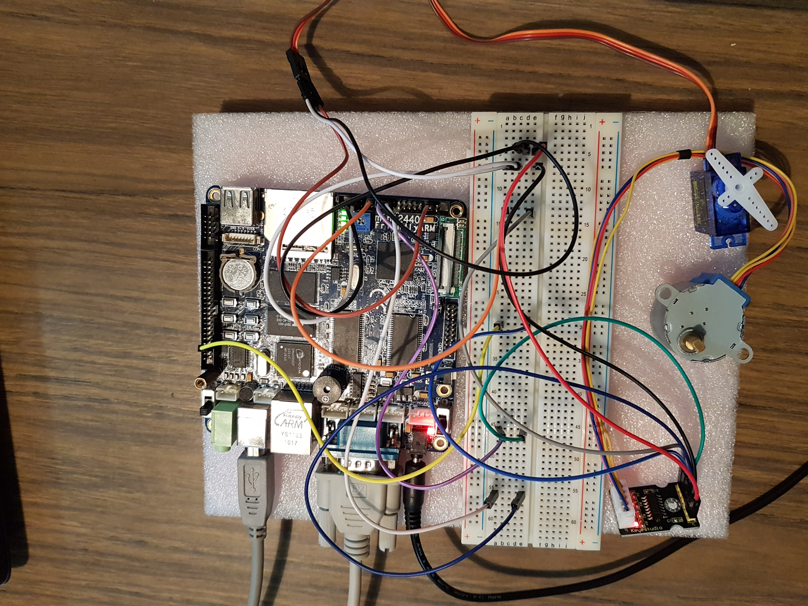

# Step-Servo-Motors-Control
## [Real Time College](https://rt-ed.co.il/) - a multi-disciplinary Real-Time O.S. and Embedded Software Solutions Center, providing consulting, development, integration, training and support solutions. 
**Course:** [Real-Time & Embedded Linux](https://rt-ed.co.il/table-rt/rt-embedded-beginners-morning/). Subjects: C for Embedded Linux, Linux Administration, RT & Embedded Concepts,
Python, Networking, ARM Architecture Programming, Embedded Linux, Linux Kernel & device drivers, Embedded Bare Board/Embedded Linux Programming using evaluation boards.

**Course project in the course ARM:** Control servo/step motors using ARM9 microcontroller 

