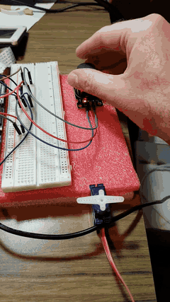
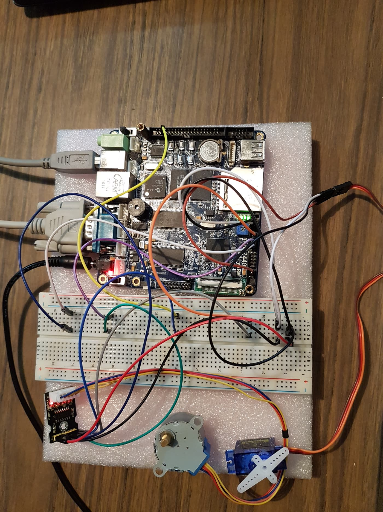

# Step and Servo Motors Control

*Course project · ARM · [Real Time College](https://rt-ed.co.il/) · 2017*

Bare-metal firmware in C for an ARM9 board (Samsung S3C2440) that controls a stepper motor and a servo motor
**through the peripheral registers directly — no HAL, no vendor library, no operating system.**

* **Servo motor:** PWM generated by hardware Timer 1 on pin GPB1, timer interrupt (IRQ) to control the speed.
* **Stepper motor:** 8-phase half-step sequence on four GPIO pins of port F (GPF1, GPF3, GPF5, GPF6).
* **Buttons:** six board buttons on port G read from the GPIO data register.
* **Joystick (first version):** 10-bit ADC conversion, joystick position → servo direction and speed.

**Language:** C. **Board:** FriendlyARM Mini2440 (Samsung S3C2440, ARM920T).
**Toolchain:** arm-elf-gcc 4.1.1, make. **Console:** RS-232 (Minicom).<br/>
Project report: [Step-and-Servo-Motors-Control.pdf](Step-and-Servo-Motors-Control.pdf).

<table>
  <tr>
    <th>Servo motor controlled by the joystick</th>
    <th>Hardware setup</th>
  </tr>
  <tr>
    <td align="center"></td>
    <td align="center"></td>
  </tr>
</table>

Full videos: [Servo-motor.mp4](Servo-motor.mp4) (first version, joystick) and
[Step-motor.mp4](Step-motor.mp4) (final version). In the stepper video an Arduino Mega board is used
**only as a 5 V power supply** for the motor driver; the motor is controlled by the Mini2440.

---

## Two versions

The project was developed in two stages, both are in the repository:

| Folder | Version | Motors | Control |
|---|---|---|---|
| [Firmware-joystick/](Firmware-joystick) | first (March 2017) | servo | joystick through the ADC, console menu |
| [Firmware/](Firmware) | final | servo and stepper | six board buttons |

## How it works

### Servo motor (Timer 1, PWM, interrupt)

* PCLK 50 MHz, prescaler 250, divider 1/4 → timer clock 50 kHz; `TCNTB1` = 1000 → **PWM period 20 ms**.
* The pulse width in `TCMPB1` selects the direction: 2% (0.4 ms) or 13% (2.6 ms) of the period.
* GPB1 is switched to the TOUT1 function in `GPBCON`; the timer runs with auto-reload.
* The Timer 1 interrupt handler stops the PWM after every two periods, waits and starts it again:
  the length of the pause sets the speed of the movement.

### Stepper motor 28BYJ-48 (GPIO)

* Four pins of port F are outputs (`GPFCON`), the motor is connected through a ULN2003 driver board.
* The 8 phases of the half-step sequence (one coil, two coils, one coil, …) are functions in an array of
  function pointers; the direction selects forward or backward order.
* The delay between phases (2–8 ms) sets the speed.

### Buttons (final version)

| Button | Action |
|---|---|
| 1 / 5 | rotate in one / the other direction while pressed |
| 3 / 6 | faster / slower |
| 4 | switch between the servo and the stepper motor |
| 2 | exit to the main menu |

### Joystick (first version)

The ADC reads the joystick position (10 bits, 0–1023). The middle position (480–543) stops the servo;
the side sets the direction and the distance from the middle sets the speed.

## Fixes made in 2026

Two typos in the stepper code of the final version were fixed in [Firmware/Timer.c](Firmware/Timer.c).
**The fixes were not tested on the board**; the videos were recorded before them.

* Phases 4, 6 and 8 must switch on two coils, but the second coil overwrote the first one (`=` instead of `|=`).
* `StopStepMotor` cleared the data register of port G (the buttons) instead of port F (the motor).

## Known limitations

* The Timer 1 interrupt handler waits for the pause between steps inside the interrupt
  (busy-wait delay on Timer 4). A better design is to only reload the timer or set a flag in the handler.
* The buttons are polled in a loop, without interrupts and without debouncing.
* Delays are busy-wait loops: the CPU does nothing else while waiting.

## My code and course code

* **Written by me:** the stepper motor control (phases, direction, speed), the servo direction and speed
  control, the button handling (`TestButtons.c`), the joystick-to-servo logic (`ADC.c`), `main.c`.
  The servo PWM and its interrupt are adapted from a course exercise (Timer 0 → Timer 1).
  The makefile and the linker script were adapted for the project.
* **Provided in the course:** startup code (`init.s`, `HAL.s`, `*.inc`), MMU setup, UART and console output,
  register definition headers, the ADC read routine, the delay function `Timer_Bdelay_Milli` and
  `Nand_Minimal.o` (no source).

## Build

Requires the `arm-elf` cross toolchain (gcc 4.1.1) in `/usr/cross/arm-elf`.

```
cd Firmware
make
```

The result `Demo.bin` (also copied as `u-boot.bin`) is loaded to the board over USB with usbpush.

## Project structure

```
Firmware/                          final version: servo and stepper, buttons
Firmware-joystick/                 first version: servo, joystick (ADC)
Documents/                         datasheets of the motors
images/                            figures for this README
Step-and-Servo-Motors-Control.pdf  project report
Hardware-Setup.jpg                 photo of the hardware setup (full size)
Servo-motor.mp4, Step-motor.mp4    videos
```
